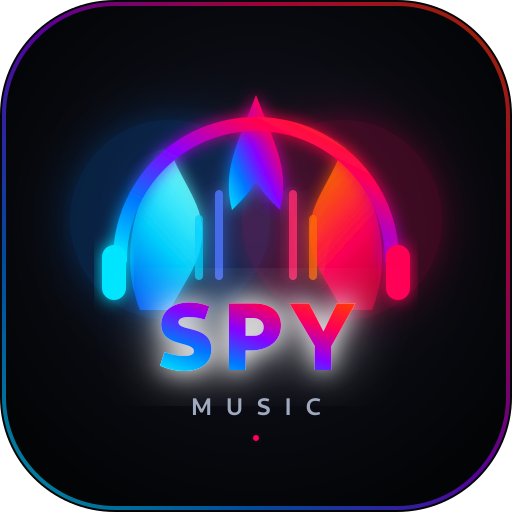

# 🔥 SPY MUSIC

  

  <b>Ultra-moderne, werbefreie Musik-Streaming-App für dein Smartphone mit Hintergrundwiedergabe, Cyber-Glow-Design & Discord-Status.</b>

  

  👉 <b><a href="https://github.com/spicy-os123-python-main/SPY-MUSIC/releases/download/v1.0.0/SPY-MUSIC.apk">Direkt-Download: SPY-MUSIC.apk (Universal für alle Handys)</a></b> 👈 
  📱 <i>Oder optimiert für moderne 64-Bit Handys: <a href="https://github.com/spicy-os123-python-main/SPY-MUSIC/releases/download/v1.0.0/SPY-MUSIC-arm64-v8a.apk">SPY-MUSIC-arm64-v8a.apk</a> | Alle Versionen unter <a href="https://github.com/spicy-os123-python-main/SPY-MUSIC/releases/latest">GitHub Releases</a></i>

---

## 📲 So installierst du SPY MUSIC auf deinem Handy

1. **Herunterladen:** Klicke oben auf den roten **DOWNLOAD APK**-Button oder öffne [Releases](https://github.com/spicy-os123-python-main/SPY-MUSIC/releases/latest).
2. **Datei öffnen:** Öffne die heruntergeladene Datei (z. B. in deiner Benachrichtigungsleiste oder im Ordner *Downloads*).
3. **Installation bestätigen:** Falls Android fragt, erlaube *"Apps aus dieser Quelle installieren"* und tippe auf **Installieren**.
4. **Fertig!** Öffne SPY MUSIC und streame alle deine Songs, Alben und Playlists 100% werbefrei.

---

## ✨ Features

- 🎧 **Multi-Plattform-Streaming:** YouTube Music, SoundCloud, Spotify & Amazon Music Treffer an einem Ort.
- 🔥 **Cyber Plasma Design:** AMOLED Dark Mode mit pulsierenden Cyan (`#00D2FF`) & Neon Crimson Flame (`#FF0055`) Glow-Effekten und flüssigen Animationen.
- 📱 **Hintergrundwiedergabe (Android Background Service):** Musik läuft ohne Unterbrechung weiter – auch wenn das Smartphone gesperrt ist oder du andere Apps nutzt.
- 💬 **Discord Rich Presence:** Zeigt deinen Freunden in Discord in Echtzeit an, welchen Song du gerade hörst.
- 📊 **3-Stufiger Data Saver Modus:** Normal, Mid und Ultra (bis zu 85% Datenvolumen sparen unterwegs).
- 🚀 **100% Werbefrei & Sicher:** Keine störenden Video-Werbungen, keine Tracking-Cookies, keine Abos.
- ⬇️ **Offline Downloads:** Songs direkt auf dem Smartphone speichern und ohne Internet hören.

---

## 🎨 Branding
- **Logo & Icons:** Zu finden unter `assets/logo/` (inklusive SVG-Vektor und hochauflösendem PNG).
- **Package ID:** `com.spymusic.app`
